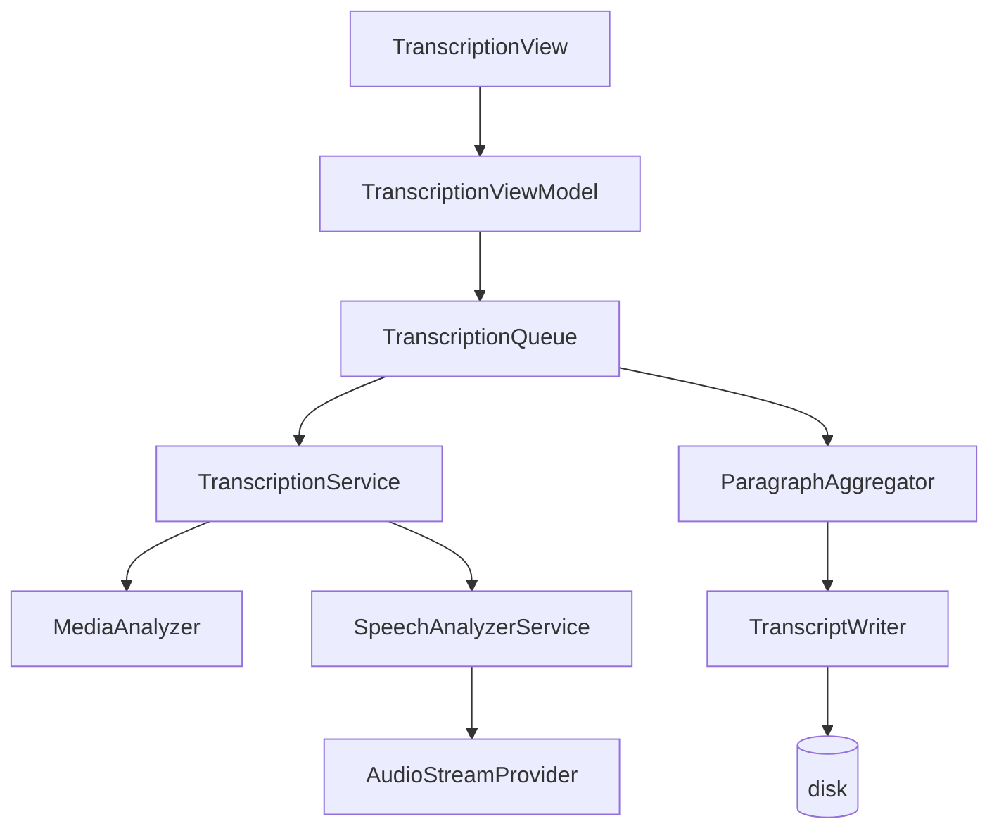

# Transcriptor

macOS Apple Silicon app that transcribes audio and video files into Markdown (.md) or plain text (.txt). All processing is local using Apple's Speech framework — no data leaves your Mac.

## Requirements

- macOS 26.0+
- Apple Silicon Mac (arm64)
- Swift 6.3+ (official swift.org toolchain; see [Development environment](#development-environment))

## Build

```sh
swift build -c release
```

The binary is produced at `.build/release/Transcriptor`.

## Run

```sh
.build/release/Transcriptor
```

The app will request the Speech framework asset for your selected language the first time you transcribe. This requires an internet connection; afterwards transcription works fully offline.

## Tests

97 tests across 21 suites covering transcription pipeline, media validation, Markdown and plain-text output, memory safety and accessibility.

```sh
swift test
```

See [Development environment](#development-environment) if you only have CommandLineTools (no Xcode).

To run the memory validation suite (requires longer media fixtures):

```sh
TRANSCRIPTOR_MEMORY_VALIDATION=1 swift test --filter Valid
```

## Build DMG

To generate a distributable DMG:

```sh
bash Scripts/build-release.sh 1.1.0
```

Output: `build/Transcriptor-1.1.0.dmg`

> **Note:** The app is ad-hoc signed. Gatekeeper will block it on first open. To work around this: right-click → Open in Finder, or run `xattr -cr /Applications/Transcriptor.app`. To use a real Developer ID certificate, see `Scripts/notarize.sh`.

## Usage

1. Open Transcriptor
2. Drag audio/video files onto the drop zone, or click **Seleccionar archivos…**
3. Select the transcription language (Spanish by default)
4. Toggle **Incluir timestamps** to add paragraph timestamps to the output
5. Choose the output type in **Formato**: *Markdown (.md)* (default) or *Texto (.txt)*
6. Click **Transcribir** (or press `⇧⌘T`)
7. The generated file appears in the destination folder (Movies by default), named after the source file (`reunion.md` / `reunion.txt`, with `-2`, `-3`… if it already exists)

**Output formats:**

| Formato | Without timestamps | With timestamps |
|---|---|---|
| Markdown (.md) | `# título`, then paragraphs | each paragraph preceded by `### [HH:MM:SS]` |
| Texto (.txt) | title line, then paragraphs | each paragraph starts with `[HH:MM:SS] ` |

**Supported formats:** mp3, m4a, wav, mp4, mov, m4v

**Keyboard shortcuts:**
| Shortcut | Action |
|---|---|
| `⇧⌘T` | Start transcription |
| `⇧⌘C` | Cancel all |
| `⇧⌘L` | Open log window |

## Architecture



All media processing is streaming — no full file or audio track is ever loaded into memory.

## Releases

Releases are built and published automatically by `.github/workflows/release.yml` when a tag starting with `v` is pushed:

1. Bump `CFBundleShortVersionString` / `CFBundleVersion` in `Assets/Info.plist`, commit and push to `main`.
2. Create and push the tag (the version is the tag name without the `v`):

   ```sh
   git tag -a v1.2.0 -m "Transcriptor 1.2.0"
   git push origin v1.2.0
   ```

3. The workflow (runner `macos-26`) installs the official Swift 6.3.3 toolchain from swift.org, runs `Scripts/build-release.sh <version>` and publishes a GitHub Release with `Transcriptor-<version>.dmg` attached. Pushing the same tag again replaces the DMG.

Follow it with `gh run watch` and open it with `gh release view v1.2.0 --web`.

Avoid launching the workflow manually from the Actions tab without a tag: the version would be `main`.

## Development environment

Without Xcode (only CommandLineTools) the system `swift test` finds no tests. Use the official toolchain installed with Homebrew (`brew install swift`):

```sh
TOOL=/opt/homebrew/opt/swift/Swift-6.3.xctoolchain/usr/bin
SDKROOT=/Library/Developer/CommandLineTools/SDKs/MacOSX26.5.sdk "$TOOL/swift" test
```

`SDKROOT` is needed when the default CommandLineTools SDK is newer than the toolchain supports (e.g. macOS 27 SDK with Swift 6.3, which fails with `cannot find type 'Locale'`). If the project folder was moved, delete `.build` to avoid stale module-cache errors.

## OpenSpec

The full design documentation (proposal, specs, tasks, design decisions) lives in `openspec/`.
